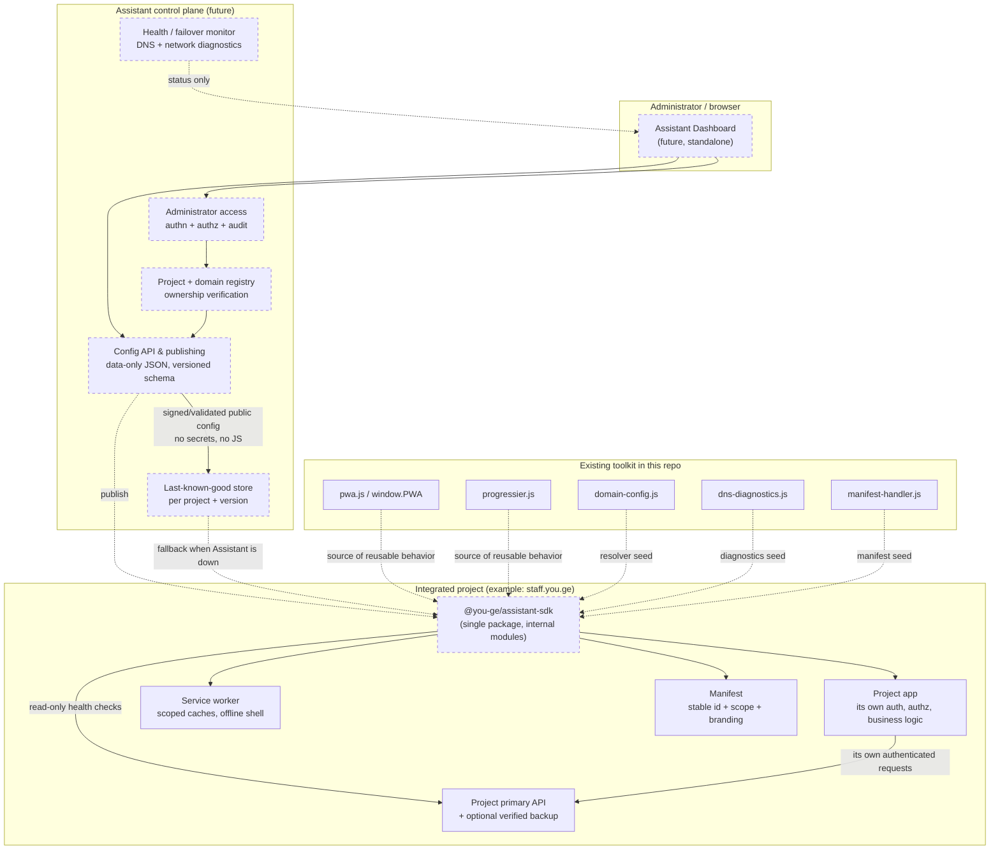

# You.Ge Assistant — Platform Architecture Foundation

**Status:** foundation only. This document defines the target architecture and
the roadmap. It does **not** implement the dashboard, the SDK package, central
configuration publishing, domain verification, failover, or
`staff.you.ge` integration. The existing PWA toolkit remains the working
runtime; see [`FOUNDATION_AUDIT.md`](FOUNDATION_AUDIT.md) for what exists today
and [`INSTALLATION_EXPERIENCE.md`](INSTALLATION_EXPERIENCE.md) for the install
contract.

---

## 1. What You.Ge Assistant is

**You.Ge Assistant** is a reusable PWA management and infrastructure platform.
It has two independent deliverables:

1. **Assistant Dashboard** — a standalone application where administrators
   register projects and domains, verify ownership, configure PWA/installation
   behavior, inspect network/DNS health, publish configuration and manage
   access.
2. **`@you-ge/assistant-sdk`** — one public package with internal modules that
   integrated projects embed to consume published configuration and reuse
   installation, manifest, offline and diagnostics capabilities.

The current repository (`sandro-defender/PWA-Helper`) is the toolkit the platform
grew from. Its runtime files, public `window.PWA` API, worker path, install
identity and dependency-free embedding model stay intact. The Assistant adds
management and distribution around them; it does not become a runtime
dependency of an integrated app.

**Independence principle:** the dashboard and every integrated project must keep
working when the other is unavailable. An Assistant outage must never prevent
`staff.you.ge` (or any project) from loading, authenticating users or serving
its own business logic.

## 2. Relationship to the existing pwa-helper

| Existing pwa-helper | Assistant platform |
| --- | --- |
| Static files copied into a project | Dashboard publishes validated, versioned configuration; SDK consumes it |
| `domain-registry.js` edited by hand | Verified project/domain registry with ownership proof and approval |
| `pwa.js` install section | `@you-ge/assistant-sdk/install` (documented contract, not yet extracted) |
| Static `manifest.webmanifest` + optional edge handler | Manifest utilities with per-project stable IDs, icons and scopes |
| `progressier.js` host/scope cache namespace | Offline shell utilities with project-isolated namespaces |
| `dns-diagnostics.js` on-demand DoH | SDK DNS/network diagnostics + dashboard health views |
| No failover | Future primary/backup endpoint engine with recovery and notifications |
| No auth | Dashboard administrator access; projects keep their own auth |

Nothing in this PR renames `/progressier.js`, `window.PWA`, CSS class names,
cookie names, IndexedDB stores or the legacy manifest `id`. Repository URLs and
environment variable names are intentionally unchanged.

## 3. Architecture diagram



Dashed arrows are future integration points. Solid arrows are existing or
project-owned flows. The SDK never sits between an app and its authenticated
business API, and the Assistant is not on the critical path of a project page
load.

## 4. Future dashboard architecture (Phase 3+)

A standalone app (framework decision deferred) with these bounded contexts:

- **Projects** — registration, stable `projectId`, environment, status.
- **Domains** — apex/subdomain/custom-domain registration, ownership
  verification (DNS or HTTP challenge), approval state, canonical origin.
- **PWA settings** — manifest name/short name/id/scope/start URL/icons/display,
  installation behavior, iOS/generic instruction copy, feature flags.
- **Network/DNS diagnostics** — on-demand DoH results, app-origin health,
  cautious classification; no claim of proving ISP blocking.
- **Endpoints** — primary and backup API configuration, health policy, failover
  and recovery settings (configuration only in Phase 3).
- **Publishing** — draft → validate → publish → version → rollback; immutable
  published revisions.
- **Health & failover monitoring** — read-only status, never a write path.
- **Administrator access** — authentication, authorization, audit log,
  project-scoped permissions.

The dashboard is **not** a runtime dependency. It writes configuration; the SDK
reads a cached, last-known-good copy.

## 5. Future SDK architecture (Phase 2+)

One public package, `@you-ge/assistant-sdk`, with internal modules. Do not
prematurely split into multiple npm packages. Proposed module boundaries
(interfaces only; no empty folders created in this PR):

| Module | Responsibility | Existing seed |
| --- | --- | --- |
| `project/domain-resolver` | Normalize hostname/origin/path, resolve project config, safe unknown-host defaults | `domain-config.js` |
| `config` | Bundled defaults → published config → project overrides → last-known-good; schema/version validation | `domain-registry.js`, `manifest-handler.js` |
| `install` | `beforeinstallprompt`, `appinstalled`, iOS/generic instructions, banners, brandable copy, namespaced dismissal state | [`INSTALLATION_EXPERIENCE.md`](INSTALLATION_EXPERIENCE.md) |
| `manifest` | Validate/build manifest fields, keep stable `id`/scope/icons, never derive identity from an untrusted Host | `YouGeDomain.manifest`, `manifest-handler.js` |
| `network-diagnostics` | App-origin health, online/offline signals, bounded timeouts | `dns-diagnostics.js` |
| `dns-diagnostics` | Cloudflare DoH A/AAAA with cautious classifications | `dns-diagnostics.js` |
| `failover` | Primary/backup selection, automatic recovery, read-only retry policy, no silent write replay | new |
| `offline-shell` | Precache/offline fallback, project-isolated cache namespace | `progressier.js`, `offline.*` |
| `connection-status` | Accessible status indicators and notifications | `pwa.css`, `example/` design reference |

**Extraction rule:** move behavior only after the current `window.PWA` behavior
is covered by tests. The install module keeps the frozen public contract in
[`INSTALLATION_EXPERIENCE.md`](INSTALLATION_EXPERIENCE.md#2-backward-compatibility-contract-freeze-before-extraction).

## 6. Multi-domain configuration strategy

- **Automatic hostname/origin detection** from `location` (injectable in tests),
  normalized by the existing resolver. On the server, derive host from the
  trusted request URL and validate it against the verified registry — never
  trust an arbitrary `Host` header as authority.
- **Project-specific configuration** keyed by `projectId` and verified domains,
  with exact-host precedence over constrained wildcard entries and path-scoped
  overrides for multiple apps on one origin.
- **Global defaults** remain safe and feature-limited: neutral branding,
  same-origin-only URLs, no privileged endpoints, no secrets.
- **Unknown domains** receive defaults; they are never treated as verified,
  never granted admin capability and never used to select another project's
  config or cache.
- **Isolated configuration and caches:** config revisions, IndexedDB stores,
  `localStorage` keys and Cache Storage names include `projectId`/origin/scope.
  The worker already namespaces caches by hostname + scope + version.
- **Domain verification** is a separate dashboard workflow (ownership proof and
  approval). Hostname detection is **never authentication**.
- Custom domains and subdomains are first-class; `staff.you.ge` is only one
  example entry, never a global constant in reusable code.

## 7. Configuration publishing strategy

```
bundled defaults  →  central published revision  →  project overrides
                         ↓ (validation failure)
                  last-known-good revision (per project, versioned)
```

- Published config is **data-only JSON**: identity, manifest fields, feature
  flags, installation copy, endpoint metadata, diagnostics policy. No
  executable JavaScript, no `eval`/`Function`, no script URLs, no secrets,
  tokens, private keys or per-user data.
- Each revision carries `schemaVersion`, `revision`, `projectId`, `publishedAt`
  and a compatibility range. The SDK rejects unknown majors, ignores unknown
  optional fields, and falls back to last-known-good on validation failure.
- Responses are served with `private, no-store`, `Vary: Host`, and a
  same-origin scope check (pattern already used by `manifest-handler.js`).
- Publishing is explicit (draft → validate → publish). Rollback selects a prior
  immutable revision. No automatic mutation from a hostname.
- Static hosting without an edge function continues to use the static fallback
  manifest; client-side hostname detection cannot change served manifest bytes.

## 8. Security boundaries

1. Dashboard and each project operate independently; Assistant downtime does not
   break project pages, auth or business logic.
2. Projects retain their own authentication, authorization and business logic;
   the SDK never proxies authenticated writes.
3. No secrets in public configuration, registry, manifests, client bundles,
   cache or logs.
4. Domain configuration is verified and validated; detection alone grants no
   access.
5. No arbitrary `Host` header trust; no unsafe cross-origin redirects;
   protocol-handler redirect targets are same-origin unless explicitly
   allowlisted.
6. No cross-project cache or private-data leakage; cache namespaces and storage
   keys are project/origin/scope scoped.
7. Service worker scope and cache namespaces are isolated; cleanup deletes only
   this kit's known namespaces.
8. Sensitive authenticated API responses are not cached by default; `private`,
   `no-store`, `no-cache`, `authorization` and non-`public` navigations are
   excluded.
9. No silent replay of write operations; failover retries only explicitly
   idempotent reads.
10. Preserve existing PWA installation identity and scope; never change a
    launched app's manifest `id` or worker path silently.

## 9. Future network resilience architecture

The failover module (Phase 4, **not implemented here**) will support:

- Project-configured **primary** and **backup** API endpoints, selected only
  from verified config; health checks are read-only and bounded by timeouts.
- **Automatic failover** to a healthy backup on classified primary failure, with
  **automatic recovery** back to primary after a stability window.
- **User notifications** through accessible connection-status surfaces; never a
  silent switch of authenticated state.
- **Network and DNS diagnostics** reused from `dns-diagnostics.js`, with the
  existing caution: Cloudflare DoH results do not prove device/ISP DNS behavior.
- No caching of authenticated responses, no write replay, no cross-project
  endpoint sharing.

**Example values for a future project configuration, not SDK defaults:**

| Purpose | Example value | Rule |
| --- | --- | --- |
| Future `staff.you.ge` primary application | `https://staff.you.ge` | Example only. |
| Future `staff.you.ge` backup API | `https://staff-you-ge.sandro-1990.workers.dev` | Example only; project-specific config, never a global default, never hardcoded in reusable runtime. |

> The Preview Worker URL above is an example for future configuration and must
> not be treated as an approved production backup. Sandbox/preview URLs
> (`*.e2b.app` and similar) are never production infrastructure. Backup
> authentication, endpoint ownership, write semantics and failover policy all
> require inspecting the real `staff.you.ge` implementation first.

## 9.5. Intelligent Floating Assistant (implemented on this branch)

Phase 1.5 delivers the reusable widget described in [`WIDGET.md`](WIDGET.md).
It is a core SDK feature, not dashboard decoration, and is available on every
configured page after initialization:

- `assistant-state.js` is the centralized, event-driven state model. It owns
  project identity, install capability/status, network/DNS/primary/backup/
  session state, available actions, the fixed priority ladder, badge,
  appearance and dismissed/acknowledged notices.
- `assistant-widget.js` (dependency-free DOM) and `example/src/main.jsx`
  (React + React Bits) are thin renderers of that one snapshot. Neither owns a
  second state model, calls `fetch`, registers a service worker, polls, or
  auto-opens.
- The existing `pwa.js` install flow and `progressier.js` worker are preserved.
  Install/diagnostics actions delegate through `[data-pwa-install]` /
  `[data-pwa-diagnostics]` rather than issuing duplicate prompts or requests.
- `YOU_GE_ASSISTANT_CONFIG` is a data-only SDK interface for enablement,
  branding, position/offsets, modules, notification behavior, project actions,
  features and theme. No dashboard is contacted after initialization.
- Project-published `youge:endpoint-status`, `youge:session-status`,
  `youge:dns-result` and `pwa:*` events drive updates. Endpoint/session health
  is published, not probed; domain detection is never authentication.
- `demo/index.html`, `example/index.html`, `offline.html` and `snippet.html`
  demonstrate the same state model across vanilla DOM, React and offline
  surfaces. The Pages workflow and Vite middleware deploy/serve the three new
  runtime files to both app scopes; the worker precaches them.

This does **not** implement a management dashboard, published SDK package,
remote config service, production failover, `staff.you.ge` integration or
backup authentication. Those remain in the roadmap below.

## 9.6. Phase 2 — SDK extraction boundaries and compatibility controls

Phase 2 extracts the reusable, framework-independent SDK into
`packages/assistant-sdk` (`@you-ge/assistant-sdk`, private/unpublished) while
preserving the existing classic-script PWA toolkit without breaking changes:

### Extraction boundaries

| Layer | Modules / files | Responsibility |
| --- | --- | --- |
| **SDK core (`packages/assistant-sdk`)** | `src/core/`, `src/config/`, `src/domain/`, `src/diagnostics/`, `src/installation/`, `src/assistant/`, `src/adapters/`, `src/index.js`, `src/index.d.ts` | Framework-independent public API (`YouGeAssistant.create`, `YouGeAssistant.attach`, `createAssistant`, `attachAssistant`), configuration pipeline (bundled defaults → validated published config → project overrides → last-known-good), domain resolution & manifest validation, centralized state & subscriptions, explicit status updates, diagnostics/installation integration contracts, lifecycle cleanup (`destroy`), optional React external-store adapter (`./react`), and TypeScript declarations. |
| **Existing PWA toolkit (preserved)** | `pwa.js`, `pwa.css`, `progressier.js`, `domain-config.js`, `domain-registry.js`, `dns-diagnostics.js`, `manifest-handler.js`, `manifest.webmanifest`, `offline.*`, `qrcode.js` | `window.PWA` (`__pwaKit`), `window.progressier`, `/progressier.js` worker & scoped caches, `[data-pwa-install]` / `[data-pwa-diagnostics]` delegation, native/iOS/generic install flows, Cloudflare DoH implementation (`window.YouGeDns`), legacy cookies, `localStorage` and IndexedDB names, and legacy manifest `id`. |
| **UI / widget layer** | `assistant-widget.js`, `assistant-widget.css`, `example/src/main.jsx`, `example/src/FoundationPreview.tsx` | Thin DOM and React + React Bits renderers consuming the single SDK state snapshot without owning duplicate state, polling, fetching or registering a service worker. |

### Compatibility risks & controls

1. **Classic `<script>` and `importScripts` compatibility:** `pwa.js`,
   `progressier.js`, `demo/`, `offline.html` and `snippet.html` run without a
   bundler, and existing VM tests forbid ESM `import` statements inside
   `assistant-state.js`. `assistant-state.js` is synchronized directly from the
   extracted SDK core via a deterministic, zero-dependency script verified in
   `scripts/check.mjs`, keeping classic scripts and ESM modules in lockstep.
2. **Single state source across classic + ESM boundaries:** `attachAssistant()`
   (`YouGeAssistant.attach()`) attaches to an existing `window.YouGeAssistant`
   instance when present (or registers one with `__state: true`), preventing
   duplicate state stores or duplicate DOM/window event listeners on hybrid
   pages such as `example/`.
3. **No competing install or diagnostics flows:** SDK core delegates install
   prompts to `window.PWA.promptInstall()` and diagnostics to configured
   runners / `window.PWA.runNetworkDiagnostics` / `window.YouGeDns.check`
   with single-flight deduplication — never registering a second
   `beforeinstallprompt` capture handler, second service worker, or background
   poller.
4. **Safe data-only configuration & secret prevention:** Published configuration
   revisions are validated against `schemaVersion` (`1`), reject executable
   functions/`javascript:` URLs, strip secret-like keys, and fall back to
   project-scoped last-known-good (`youge-assistant:lkg:<projectId>`) or safe
   bundled defaults on failure.

## 10. Planned integration with staff.you.ge (deferred)

Sequence once the implementation is available for inspection:

1. Inventory its framework, auth/session model, API routes, CSP, service worker,
   manifest `id`, cache names, offline behavior and push endpoints.
2. Register `staff.you.ge` as a verified project with its own `projectId`;
   confirm apex/subdomain and any custom domains.
3. Map PWA settings and installation copy to the SDK install contract without
   changing the existing installed app identity.
4. Add configuration only (primary/backup endpoints) — no backup auth or
   failover yet.
5. Then, in a separate phase, pilot read-only health checks and idempotent
   failover with explicit rollback criteria.

No `staff.you.ge` integration code, endpoint constant, secret or deployment is
introduced in this PR.

## 11. Decisions that cannot be made yet

Decisions below require inspecting the **existing `staff.you.ge` implementation**
and/or the production environment; they are intentionally open:

- Existing manifest `id`, worker URL/scope, cache names and installed-user base.
- Authentication/session model, token storage, CSRF and cross-origin policy.
- Which API routes are safe for health checks, which are idempotent, and which
  writes must never be replayed.
- Whether the Cloudflare Worker example is an appropriate backup at all, its
  auth parity, rate limits, data residency and ownership.
- Real DNS/hosting topology, verified domain ownership and canonical origin.
- CSP, `Service-Worker-Allowed`, manifest MIME/CORS and redirect behavior.
- Push VAPID ownership, subscription storage migration and notification
  history compatibility.
- Dashboard framework, hosting, identity provider, database and audit needs.
- Available self-hosted GitHub runner labels (the GitHub API returns 403 in
  this session), so CI remains on `ubuntu-latest`.

Decisions already made here: single SDK package with internal modules;
data-only versioned config; last-known-good fallback; origin/scope-isolated
caches; install experience preserved behind a documented contract; no default
backup URL; no production infrastructure in this phase.

## 12. Implementation roadmap

| Phase | Goal | Depends on | Status |
| --- | --- | --- | --- |
| **0 — Audit & identity** | Re-audit repo, freeze install contract, define platform/security model, documentation, design system, tests | — | Completed (PR #6) |
| **1 — Contract hardening** | Behavioral install tests, manifest/SW/domain regression gates, TypeScript check for React example, incremental UI polish | Phase 0 | Completed (PR #6) |
| **1.5 — Intelligent Floating Assistant** | Centralized event-driven state, real-condition badges, priority ladder, in-place panel, configurable SDK interface, DOM + React Bits renderers, offline/Pages integration, tests | Phase 1 | Completed (PR #6) |
| **2 — SDK extraction** | Create `@you-ge/assistant-sdk` (private first): resolver, config, install, manifest, offline-shell, diagnostics modules behind tested adapters; keep `window.PWA` shim | Phase 1.5 | **This PR (in progress)** |
| **3 — Dashboard foundation** | Project/domain registration, domain verification, admin auth, schema-validated config drafts, publishing UI and read-only health views | Phase 2 (config schema), staff app inspection | Later |
| **4 — Resilience pilot** | Primary/backup config, read-only health checks, idempotent failover + recovery, accessible notifications | Phase 3, staff API/auth inspection, endpoint approval | Later |
| **5 — staff.you.ge pilot** | Opt-in integration with rollback plan; no identity/scope changes | Phases 2–4 | Later |
| **6 — Publish** | npm package release, versioning, changelog, docs site | Phases 2–5 + release decision | Deferred |

Phase dependencies are deliberate: no failover before endpoint/auth facts, no
publishing before schema validation, no SDK split before extraction, no npm
publish before integration validation.

## 13. Definition of done for this foundation PR

- Existing helper still works; install experience unchanged in behavior.
- Identity is clearly **You.Ge Assistant** across user-facing surfaces.
- Platform, SDK, multi-domain, publishing, security and failover architectures
  are documented with a diagram and roadmap.
- Open decisions are explicit, not guessed.
- Tests pass before and after; build + type checks pass; no dashboard, SDK
  package, npm publish, staff integration, production config or deployment in
  this PR.
- The Intelligent Floating Assistant is implemented as a reusable core widget
  with one centralized state model; see `WIDGET.md`. PR #6 stays open and
  unmerged.
